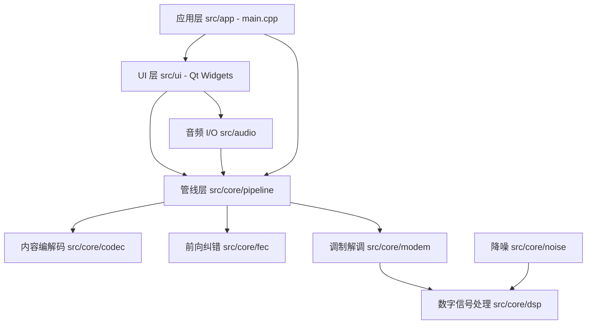

# AudioT 架构文档

AudioT 是一个基于声卡通道的音频数据传输系统：将文本、文件等数据
经编码、前向纠错（FEC）、调制后转为音频信号发送，并在接收端完成解调、
纠错、解码的逆过程。

## 1. 分层架构



### 1.1 核心层 `src/core`（静态库 `audiot_core`）

纯 C++11，无任何平台/GUI 依赖，可独立于 Qt 构建与测试。

| 模块 | 目录 | 职责 |
|------|------|------|
| 接口定义 | `interfaces/` | `IModem`、`ICodec`、`IAudioStream`、`IPipeline` 抽象 |
| 内容编解码 | `codec/` | `TextCodec`（文本帧+CRC16）、`FileCodec`（文件帧+CRC32+分片）、`ImageCodec`、`VideoCodec` |
| 前向纠错 | `fec/` | `HammingCodec`(7,4)、`ReedSolomon` GF(2^8)、`LDPCCodec`(256,128) Min-Sum |
| 调制解调 | `modem/` | `AFSKModem`(Bell 202 风格)、`MFSKModem`（FFT 4-FSK）、`DPSKModem`（差分 PSK：DBPSK/DQPSK/D8PSK，非相干差分解调）、`QAM16Modem`（16-QAM，前导辅助相干解调） |
| DSP 工具 | `dsp/` | FFT 封装、FIR/IIR 滤波器、窗函数、相关器 |
| 降噪 | `noise/` | 噪声剖面、谱减法、陷波滤波、噪声滤波 |
| 收发管线 | `pipeline/` | `TxPipeline` / `RxPipeline` 串联以上模块 |

### 1.2 音频层 `src/audio`（静态库 `audiot_audio`）

| 文件 | 职责 |
|------|------|
| `wav_writer.h/.cpp`、`wav_reader.h/.cpp` | 平台无关的 WAV 读写（16-bit PCM） |
| `qt_audio_stream.h/.cpp` | Windows/Qt 实时音频输入输出（QAudioInput/QAudioOutput） |
| `iaudio_backend.h` | 跨平台音频后端抽象接口 `IAudioBackend` |
| `alsa_audio_stream.h/.cpp` | Linux ALSA 后端原型（`#ifdef __linux__`，其他平台为空实现桩） |
| `audio_format.h` | `AudioFormat` 采样率/声道/位深描述 |

### 1.3 UI 层 `src/ui`（静态库 `audiot_ui`，可选）

Qt5 Widgets 界面：主窗口、TX/RX 面板、电台模式、音频监控、
噪声剖面对话框、设置面板。仅在 `AUDIOT_USE_QT=ON` 且找到 Qt5 时构建。

### 1.4 应用层 `src/app`

可执行目标 `AudioT`：命令行自检模式（无 Qt 时）或启动 Qt 主窗口。

## 2. 关键数据流

### 2.1 发送（TX）

```
文本 ──> TextCodec(帧头 0xAA 0x55 + 长度 + CRC16)
     ──> 字节转比特 (MSB first)
     ──> Hamming(7,4) FEC（可选，useFEC）
     ──> AFSK 调制（前导 32 bit 交替 + 数据 + 后导 16 bit）
     ──> float 采样 (-1..1, 44100 Hz)
     ──> WAV 文件 / 声卡播放
```

### 2.2 接收（RX）

```
WAV / 声卡采样 ──> AFSK 解调（Goertzel 双音能量比较 + 前导同步）
               ──> Hamming 解码（纠错）
               ──> 比特转字节
               ──> TextCodec 解码（帧校验 + CRC16）
               ──> 文本
```

## 3. 构建系统

- CMake ≥ 3.16，C++11（`CMAKE_CXX_EXTENSIONS OFF`）
- 顶层选项：`AUDIOT_USE_QT`（默认 ON，找不到 Qt5 自动关闭）、`AUDIOT_BUILD_TESTS`
- `cmake/CompilerFlags.cmake`：MSVC / MinGW / GCC / Clang 各自的警告与优化标志
- `cmake/FetchDependencies.cmake`：第三方依赖获取
- `cmake/deploy.cmake`：Windows + Qt 环境下构建后自动调用 `windeployqt`
- 音频后端条件编译：Windows → QtMultimedia（`AUDIOT_AUDIO_BACKEND_QT`）；
  Linux → 可选 ALSA（`find_package(ALSA)`，`AUDIOT_AUDIO_BACKEND_ALSA`）

### 构建命令

```powershell
# Windows (MinGW)
D:\Qt\Tools\CMake_64\bin\cmake.exe -S . -B build64 -G "MinGW Makefiles" -DCMAKE_PREFIX_PATH=D:/Qt/5.15.2/mingw81_64
D:\Qt\Tools\CMake_64\bin\cmake.exe --build build64
cd build64; D:\Qt\Tools\CMake_64\bin\ctest.exe --output-on-failure
```

```bash
# Linux
cmake -S . -B build -DCMAKE_BUILD_TYPE=Release
cmake --build build
ctest --test-dir build --output-on-failure
```

## 4. 测试

`tests/` 下按模块划分独立测试可执行文件（CMake `add_test`）：

| 测试 | 覆盖 |
|------|------|
| `test_afsk` | AFSK 调制/解调往返、前导同步 |
| `test_fec` | Hamming(7,4) 纠错 |
| `test_reed_solomon` | RS GF(2^8) 编码/纠错 |
| `test_fft` | FFT 正确性 |
| `test_filter` | FIR/IIR 滤波 |
| `test_wav` | WAV 读写往返 |
| `test_file_codec` | 文件帧编解码与分片 |
| `test_pipeline` | 文本 → 音频 → 文本 全链路往返 |
| `test_placeholder` | 构建占位测试 |

## 5. 跨平台策略

- **核心算法零平台依赖**：`audiot_core` 仅依赖 C++11 标准库。
- **音频 I/O 抽象**：`IAudioBackend` 定义统一接口（设备枚举、输入/输出流、
  回调与写入），`createAudioBackend()` 工厂按平台返回实现：
  - Windows：当前实时路径使用 QtMultimedia；抽象层保留给未来非-Qt 场景
  - Linux：`AlsaAudioBackend`（snd_pcm）
  - macOS：CoreAudio（规划中）
- **构建降级**：Qt 缺失时自动关闭 UI、退化为命令行自检；ALSA 缺失时
  ALSA 源编译为空实现桩，仍可构建 WAV 文件模式。
